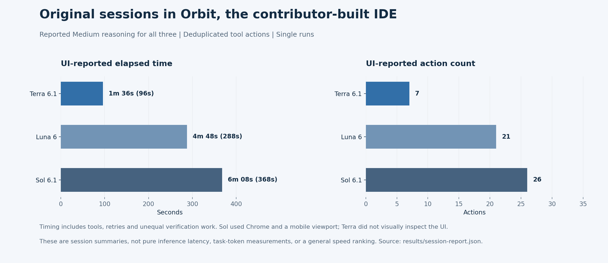
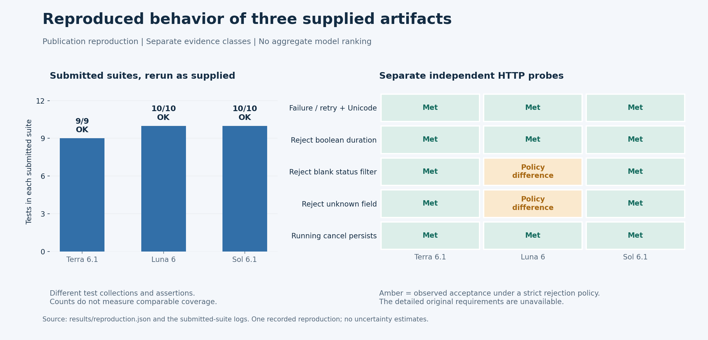

# GPT coding-agent artifact benchmark

An exploratory comparison of three supplied local job-queue implementations, labeled **Terra 6.1**, **Luna 6**, and **Sol 6.1** by the contributor. These labels identify submissions; the archive does not independently establish exact backend model versions. This is a single artifact set, not a statistically reliable model leaderboard.

## Experiment record and graphics

The supplied session extracts now document all three runs in **Orbit, the contributor-built IDE**, with Medium reasoning reported for each. The UI reports Terra **1m 36s / 7 actions**, Luna **4m 48s / 21 actions**, and Sol **6m 8s / 26 actions**. Different tool failures, self-corrections and browser checks are included in those durations; they do not establish a general speed ranking.





Read the [sanitized session report](docs/SESSION_REPORT.md) for the setup, planned rubric, model-by-model work, failed attempts, fixes, evidence boundaries and redaction choices. All **54 deduplicated actions** are summarized in [English CSV](results/session-actions.csv). The raw conversation and identifying IDE links are not published.

## What is published

| Path | Contents |
| --- | --- |
| `models/terra`, `models/luna`, `models/sol` | Original executable source, static assets, and submitted tests |
| `probes/http_probe.py` | Separately authored HTTP reproduction checks |
| `probes/reproduce.py` | Runs each submitted suite and the independent probes in separate processes |
| `results/` | Reproduction logs plus sanitized original-session data and action CSV |
| `docs/SESSION_REPORT.md` | Original setup, actions, fixes and reported outcomes |
| `assets/`, `tools/build_figures.py` | Result graphics and reproducible chart source |
| `provenance.json` | Archive digest and byte-preservation manifest |
| `docs/METHODOLOGY.md` | Evidence boundaries and reproduction procedure |
| `docs/LIMITATIONS.md` | Korean locale, Windows, encoding and generalizability limitations |

All publication documentation is English. Original executable files, tests, comments, Korean UI labels and error strings remain unchanged to preserve the experimental artifacts. Original Korean README files were replaced with English usage documentation. Do not interpret translated documentation as the original model response.

## Reproduce

Install Python 3.11 or later (the supplied requirement), clone the repository, and run from its root:

```console
python probes/reproduce.py
```

The measured environment and actual interpreter version are recorded in `results/reproduction.json`. No third-party package or model API key is needed. The runner writes fresh results, uses temporary SQLite files and loopback HTTP servers, and forces UTF-8 in child Python processes. It overwrites the checked-in result files; preserve a copy when comparing runs. A subprocess timeout is recorded separately from a test failure. Probe process exit code alone is not a pass verdict: inspect each observation's `passed` field.

To inspect a dashboard, change into one model directory, run `python app.py`, and open http://127.0.0.1:8765. Run one dashboard at a time. Jobs simulate waiting; they do not execute arbitrary commands.

## Reading the evidence

Submitted tests are model-authored and may share assumptions or mistakes with their implementation. Re-running them verifies that those tests executed; it does not make their coverage independent. The independent checks cover a small common HTTP surface and two strict validation policies. Differences in unspecified policies are observations, not proof of a benchmark violation. The later session extracts recover a task summary and planned 100-point rubric, but not the exact prompt or awarded scores. They do not establish that the two strict validation policies were requirements.

See `docs/RESULTS.md` for the observed counts and interpretation. No aggregate ranking is assigned. Runtime data, databases, bytecode, private conversation exports, credentials and temporary files are excluded.

No license is inferred from the archive; no additional rights grant is asserted by this publication.
